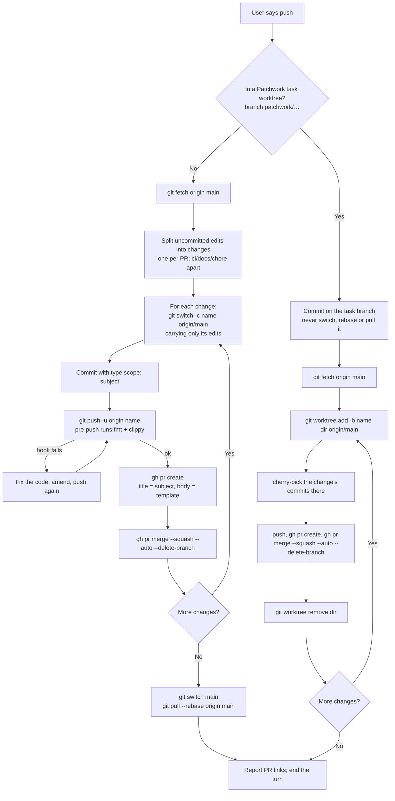
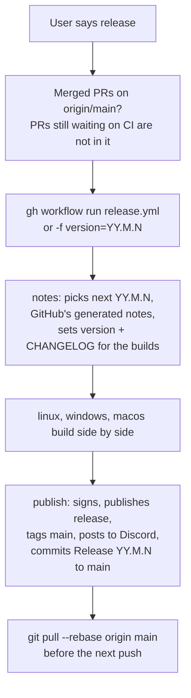

# Patchwork: agent rules

What never gets written, and how changes get from the working tree to `main` and into a release.
Run all commands from the repo root.

## No tests, harnesses, or scripts

The repo has no tests and takes none. This holds even when a task, a skill, a guideline, a review
comment, or a user request for a "fix" seems to call for one. Only an explicit request from the
user that names tests overrides it, and then only for that request.

### Never write

- **Rust tests of any kind:** `#[test]`, `#[tokio::test]`, `#[gpui::test]` or any other test
  attribute; `#[cfg(test)]` modules or items; `mod tests;` declarations; `tests/` integration
  folders; `benches/` and `#[bench]`; doctests written to be run as checks (a short usage example in
  a `///` comment is fine, but don't add doc examples to get coverage).
- **Test support code:** fixtures, mocks, fakes, stubs, sample data files, snapshot files
  (`insta`, `.snap`), golden files, test helpers, or `pub(crate)` hooks added only so a test can
  reach something.
- **Test dependencies:** `[dev-dependencies]` for testing (`proptest`, `quickcheck`, `insta`,
  `mockall`, `rstest`, `criterion`, `pretty_assertions`, and the like).
- **Harnesses and scripts:** QA harnesses, repro programs, example binaries (`examples/`), shell,
  Python or Node scripts, Makefile/justfile targets, or anything else checked in to drive or check
  the app. The only scripts are `scripts/build.sh` and `scripts/hooks/`; add nothing beside them.
- **CI test steps:** no `cargo test`, `cargo nextest`, coverage, or benchmark jobs in
  `.github/workflows/`.
- **Commits typed `test`:** with no tests, there is nothing for a `test(...)` commit to change.

### Verify instead

Every change still gets checked; the check is just not saved.

1. **Compile and lint:** `cargo fmt --all` and `cargo clippy --workspace -- -D warnings`, both with
   zero warnings.
2. **One-off commands run inline:** `cargo run -p patchwork`, `cargo check -p <crate>`, a `gh`,
   `jq`, `git` or `uvx` command typed into the shell. If a command needs a scratch file, put it in
   gitignored `research/<job>/` (never `/tmp`) and delete it when done.
3. **The real app:** for behavior, run your own debug build (`cargo run -p patchwork`, in the
   background, stopped by PID when done; never stop an instance you did not start) and reproduce
   the bug or exercise the feature.
4. **UI changes:** say exactly what the user should check in the app: where to click, what to type,
   and what they should see.
5. **Report what was verified** and what was not, with the failing output when something fails.

If you find a test, harness, or script that slipped in, point it out and ask before deleting it.

## Ground rules

- **Push finished work.** Once a change is verified, run the [push flow](#push-the-pr-flow)
  without waiting to be asked. Leave it uncommitted only when the user says to hold it.
- **Every change reaches `main` through a squash-merged PR.** The ruleset on `main` requires a PR
  and passing CI. Only the Release workflow pushes to `main` directly.
- **One PR per change.** CI, docs and tooling go in their own PR with a `ci`, `docs` or `chore`
  commit, never mixed into a feature or fix.
- **Branch every PR from fresh `origin/main`**, never from another PR's branch or from local `main`.
- **No destructive git** without explicit confirmation: `reset --hard`, `checkout -- <file>`,
  `restore`, `stash`, `clean -f`, force-push, moving or deleting pushed tags, rewriting pushed
  history. A hook in `.claude/settings.json` blocks most of these.
- **Ask before deleting, moving, or renaming files.**
- **No AI attribution.** No `Co-Authored-By: Claude` or "Generated with" lines in commits or PRs.
- **Don't watch GitHub Actions runs** unless asked.

## Commit subjects and PR titles

Plain-language conventional commits, written as what users see now:

```
type(scope): what users see now
```

| Type | For |
|---|---|
| `feat` | Something users can do that they could not before |
| `fix` | Something that was broken now works |
| `perf` | Something is faster or lighter |
| `refactor` | Code moved or reshaped, no change users see |
| `docs` | Documentation only |
| `ci` | Workflows and CI |
| `chore` | Tooling, dependencies, housekeeping |

Examples: `fix(chat): new threads no longer spike CPU`,
`feat(settings): synced backgrounds, Chat and Logs panes`. The PR title is the commit subject, and
the squash merge appends ` (#N)`. GitHub's generated release notes list these titles, so they are
the changelog: write them for users.

## Before any commit

```sh
cargo fmt --all
cargo clippy --workspace -- -D warnings
```

Both must pass with zero warnings. The `scripts/hooks/pre-push` hook runs the same checks (plus
`node --check site/site.js`) when `git config core.hooksPath scripts/hooks` is set. Never use
`--no-verify` to get past a failure; fix the code.

## "Push": the PR flow

A verified change, or the user saying "push" or "push to git", runs this whole flow without asking
again.



### Step by step (on `main`)

1. `git fetch origin main`.
2. Sort the uncommitted edits into changes. Each change becomes one branch and one PR. Keep `ci`,
   `docs` and `chore` edits apart from code changes.
3. For each change, create its branch from `origin/main`, carrying only that change's edits.
   Don't touch local `main`, and don't use `stash`; to carry edits across a switch, commit them on
   the new branch directly (`git switch -c <name> origin/main` keeps uncommitted edits that don't
   conflict), and leave the other changes' edits uncommitted for their own branches.
4. Commit with the subject from [Commit subjects and PR titles](#commit-subjects-and-pr-titles) and
   push with `git push -u origin <name>`.
5. Open the PR with `gh pr create`. The title is the commit subject. The body fills in
   `.github/pull_request_template.md` (Problem, Change, Scope, Verification) in plain prose, no AI
   fluff.
6. Turn on auto-merge: `gh pr merge --squash --auto --delete-branch`.
7. After the last PR, `git switch main` and `git pull --rebase origin main`. Don't cherry-pick
   unmerged PRs onto local `main`; they arrive with the pull once merged.

### In a Patchwork task worktree (`patchwork/…` branch)

Never switch, rebase, or pull the task branch.

1. Commit the work on the task branch.
2. `git fetch origin main`.
3. For each change: `git worktree add -b <name> research/pr-<name> origin/main`, cherry-pick its
   commits there, push, `gh pr create`, `gh pr merge --squash --auto --delete-branch`.
4. Remove the temporary worktree with `git worktree remove research/pr-<name>`.

### When a PR's CI fails

Fix it on the same branch, commit, and push again; auto-merge picks up the new run. Don't
force-push a branch that is under review without asking.

## "Release"

Releases are cut from `origin/main` by the Release workflow. Never bump versions or write
`CHANGELOG.md` entries by hand. Details are in [docs/release.md](docs/release.md).



- Start it with `gh workflow run release.yml`. Manual tagging also works:
  `git fetch origin --tags && git tag <YY.M.N> origin/main && git push origin <YY.M.N>`.
- Tags are `YY.M.N` with no `v`.
- After it finishes, `main` has a `Release YY.M.N` commit; pull it before the next push.
- To reword published notes, edit the GitHub release and its `CHANGELOG.md` section in a `docs`
  PR.
