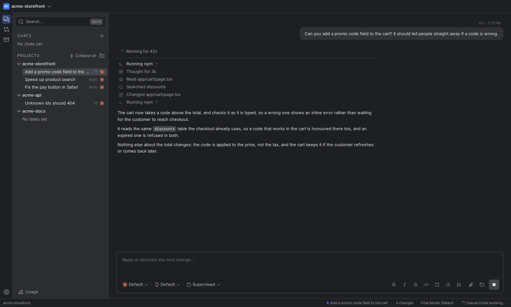
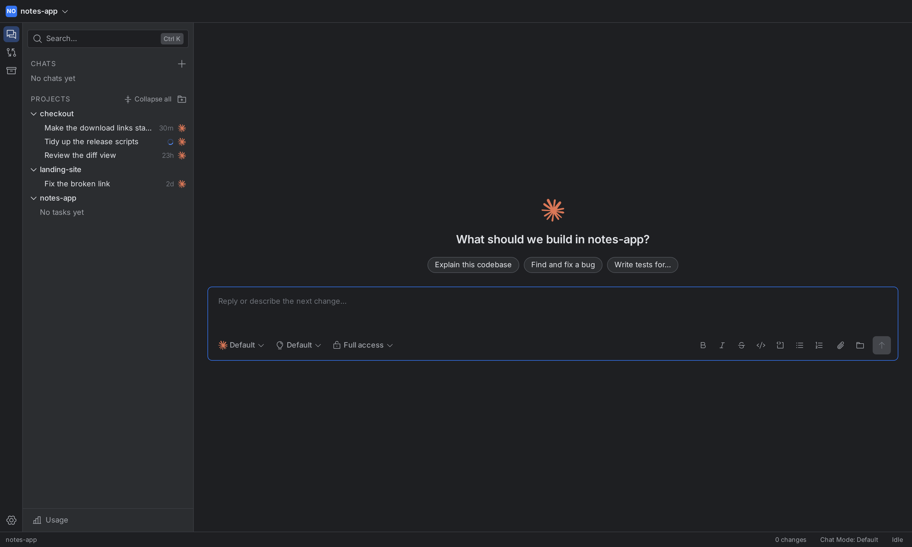
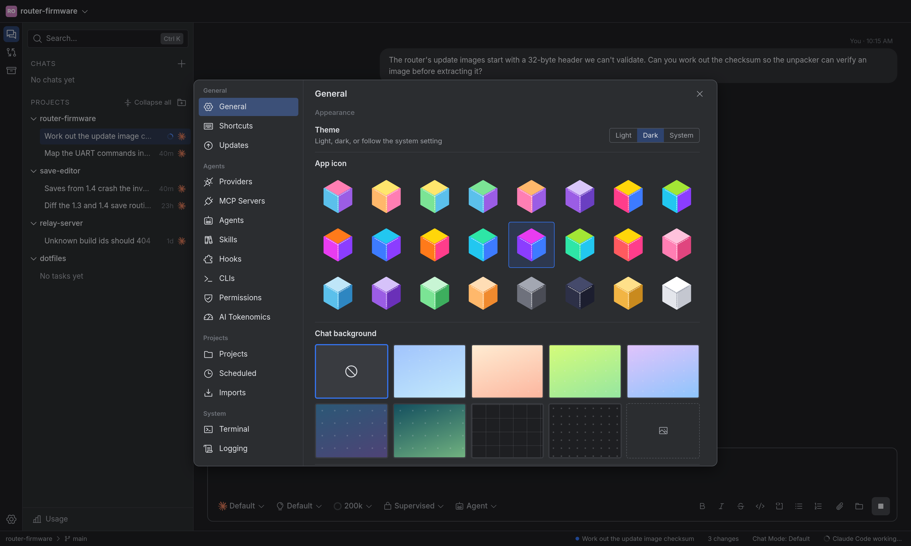
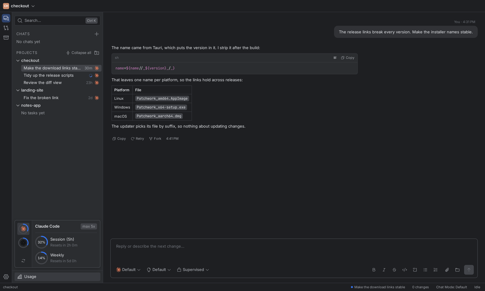

# Patchwork

**A desktop workspace for coding agents.** Run Claude Code, Codex, Antigravity, OpenCode, or any
OpenAI-compatible model from one place — then review every change before you keep it.

<table>
  <tr>
    <td></td>
    <td></td>
  </tr>
  <tr>
    <td></td>
    <td></td>
  </tr>
</table>

Coding agents are good at writing code and bad at staying out of your way. Patchwork gives them a
shared home: one sidebar for projects, tasks, and chats, one canvas to read their work, and one
place to decide what survives. It does not replace the CLIs you already trust — it drives them.

## Why Patchwork

- **One interface for every agent.** Claude Code, Codex, Antigravity, OpenCode, and API models share
  the same chat, plan, and code views. Switch agents without switching apps.
- **Nothing lands until you say so.** Each task has a canvas of its Plan, Code, and Diff views.
  Stage the files you want with `git add`, and reject a file to restore it.
- **You decide how much rope.** Supervised, auto-accept edits, auto, or full access, chosen per
  task. Approval requests arrive in the chat, where the work is.
- **Goals and steering.** Give the agent a `/goal` to work toward, or send a message mid-turn to
  steer it. Turn an afternoon of babysitting into one instruction and one review.
- **Bring your own key.** Add DeepSeek or any OpenAI-compatible endpoint under
  **Settings → Providers**. Keys live in your system keychain, not in the app's database.
- **It reads what your agent already wrote.** Import past conversations from Claude Code, Codex, the
  Gemini CLI, or [T3 Code](https://github.com/pingdotgg/t3code) — each becomes a task whose
  follow-ups resume the original session.
- **Artifacts, drawn in place.** A Mermaid diagram, an HTML mock, or an SVG chart in a reply renders
  in the chat, in a sandboxed frame that cannot reach the rest of the app.
- **Runs on your machine.** No account, no proxy, no telemetry server. Requests go from your
  computer to your provider.

It also handles the long tail: scheduled tasks, plugin bundles with skills and MCP servers, a
subscription **Usage** view, and an optional screen tool that asks before it clicks anything.

## Download

| Platform | Download |
| --- | --- |
| Linux | [`Patchwork_amd64.AppImage`](https://github.com/PolarisPyra/Patchwork-ADE/releases/latest/download/Patchwork_amd64.AppImage) |
| Windows | [`Patchwork_x64-setup.exe`](https://github.com/PolarisPyra/Patchwork-ADE/releases/latest/download/Patchwork_x64-setup.exe) |
| macOS (Apple silicon) | [`Patchwork_aarch64.dmg`](https://github.com/PolarisPyra/Patchwork-ADE/releases/latest/download/Patchwork_aarch64.dmg) |

Those links always serve the newest release. On Linux, make the AppImage executable and run it:

```sh
chmod +x Patchwork_amd64.AppImage
./Patchwork_amd64.AppImage
```

Once installed, Patchwork updates itself and verifies each update's signature before installing it.
To build from source, see [Development](docs/development.md).

## Requirements

Patchwork drives the agent CLIs you already have. Install at least one and sign in with its own
login command — Patchwork detects it and uses it as it is:

- [Claude Code](https://docs.claude.com/en/docs/claude-code) (`claude`)
- [Codex](https://github.com/openai/codex) (`codex`)
- [Antigravity](https://antigravity.google/) (`agy`)
- [OpenCode](https://opencode.ai/) (`opencode`)

No CLI? Add an API provider under **Settings → Providers** and use Patchwork's built-in agent
instead, which reads, searches, edits, and runs commands itself.

## Getting started

1. Open Patchwork and add a project folder.
2. Click **+** in the project to start a task, then pick an agent and an access mode.
3. When the agent finishes, review the changes in the canvas. Stage what you want, reject the rest.

To try an agent without a project, start a chat from the top of the sidebar. It runs in a scratch
folder that is deleted with the chat.

## Your data

- What you edit (skills, agents, plugins, MCP servers, API providers) is in `~/.config/patchwork`. State lives in SQLite at `~/.local/share/patchwork/patchwork.db`. `~/.cache/patchwork` is rebuilt when deleted, and logs are in `~/.local/state/patchwork/logs`. macOS and Windows use their own folders (see `docs/architecture.md`).
- Tasks run directly in your project folder. Chats run in a scratch folder, deleted with the chat.
- The agent CLIs do the work and talk to their own services. Patchwork reads the files they save,
  such as session transcripts, to show history and usage — [Agent CLIs](docs/agent-clis.md) lists
  every file and command it touches.
- API keys, and the values of any custom headers, are kept in the system keychain (macOS Keychain,
  Windows Credential Manager, or the Secret Service on Linux). On a system without one, they go to a
  file only you can read. A provider can also read its key from an environment variable. Requests go
  straight from your machine to the provider.

## Documentation

Building or changing Patchwork:

- [Development](docs/development.md): build, run, and test
- [Architecture](docs/architecture.md): repo layout and the data model
- [Agent CLIs](docs/agent-clis.md): how each agent is detected, run, and imported
- [All docs](docs/README.md)

## Contributing

Bug reports, fixes, and guides are welcome. Start with [CONTRIBUTING.md](CONTRIBUTING.md), and see
[CHANGELOG.md](CHANGELOG.md) for what changed in each release.

## License

Patchwork is free software under the [GNU Affero General Public License, version 3 or
later](LICENSE) (AGPL-3.0-or-later), with no warranty.

The AGPL lets you use, study, change, and share Patchwork, provided that anything you distribute, or
run as a network service, is offered under the same license with its source. If that does not suit
you — closed-source integration, or a product you cannot publish under the AGPL — a **commercial
license** is available instead; open an issue titled "Commercial license". That dual licensing is
how the project is funded.

The license covers the code. The Patchwork name and logo are not licensed with it, so a fork needs
its own name.
