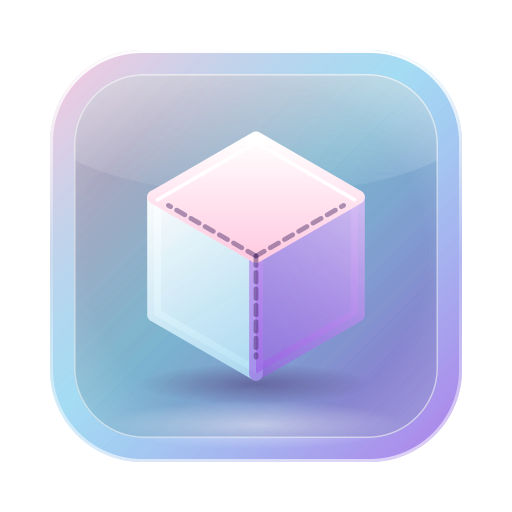
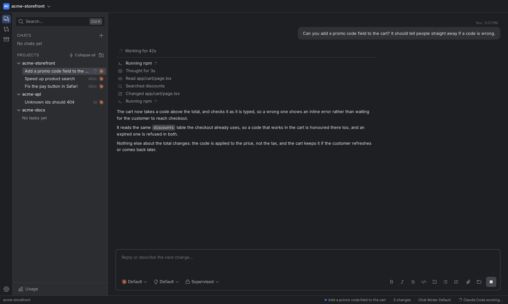
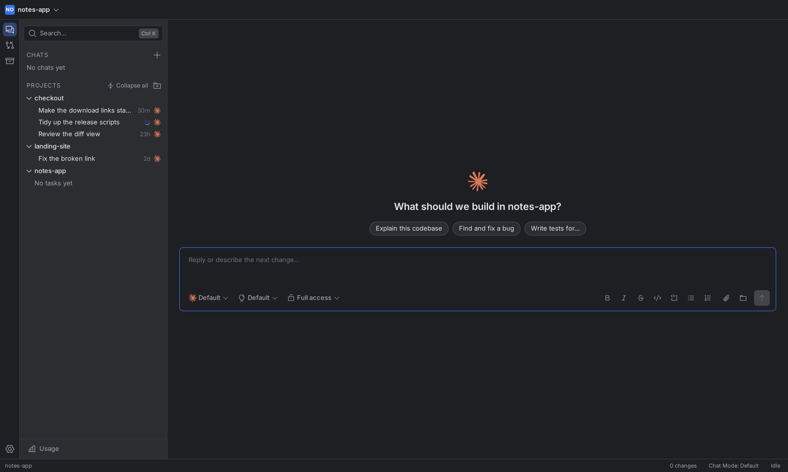
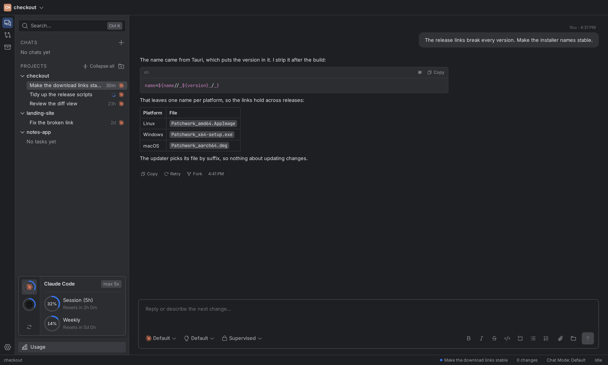
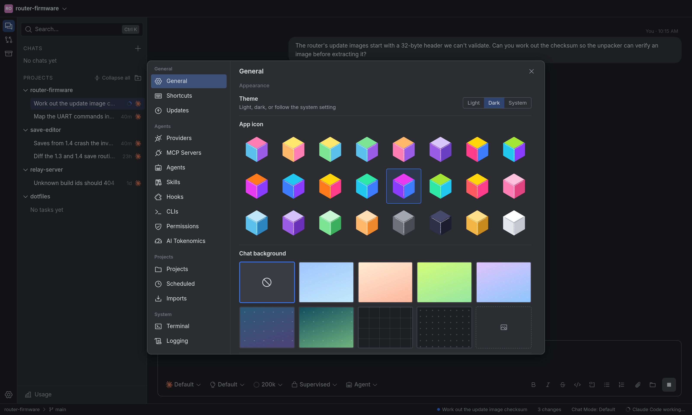
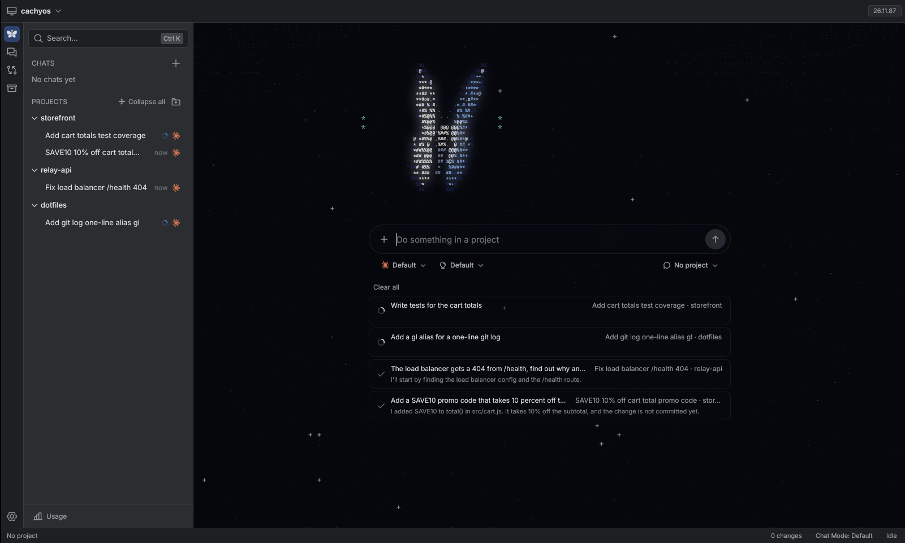
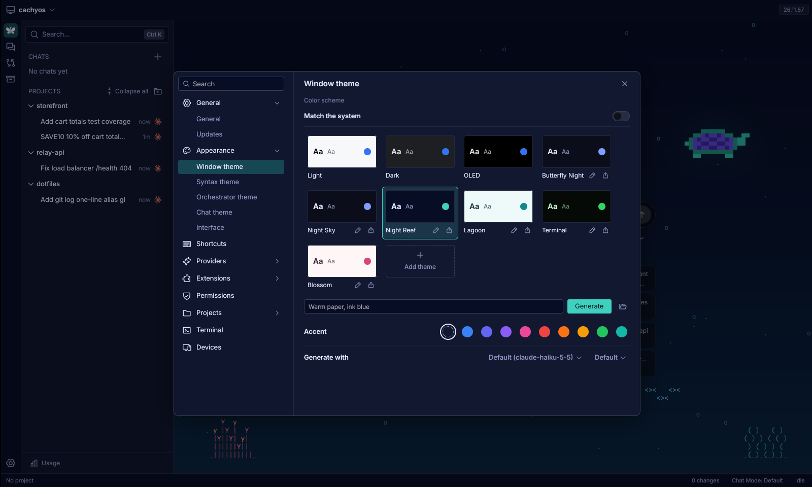
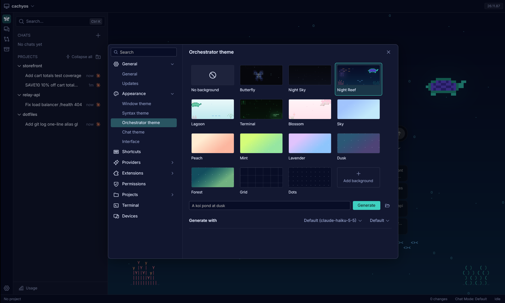
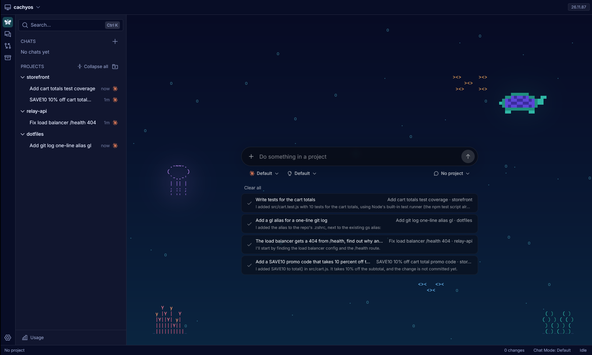

  

<h1 align="center">Patchwork</h1>

  All your coding agents, in one window. 
  Claude Code, Codex, Antigravity and OpenCode, with API support. Free, with no account and no telemetry.

  
  
  

  <a href="https://patchworkeditor.com">Website</a> ·
  <a href="#download">Download</a> ·
  <a href="docs/README.md">Docs</a> ·
  <a href="https://ko-fi.com/polarispyra">Donate</a>

  

<table>
  <tr>
    <td></td>
    <td></td>
    <td></td>
  </tr>
</table>

## What it does

You probably already have an agent CLI you like. Patchwork gives it a proper home: your projects
and tasks in a sidebar, and the agent's work laid out step by step as it goes.

- **Every agent, one window.** Claude Code, Codex, Antigravity, OpenCode, and API models all get
  the same chat, plan, and code views. Switching agents is a dropdown, not a new app.
- **You choose how much it does alone.** Supervised, auto-accept edits, auto, or full access, set
  per task. When it needs permission, it asks in the chat.
- **Set a goal, steer as it goes.** Hand it a `/goal` and walk away, or send a message mid-turn to
  change course.
- **API support.** DeepSeek or any OpenAI-compatible endpoint works from
  **Settings → Providers**.
- **Pick up old sessions.** Import past conversations from Claude Code, Codex, the Gemini CLI, or
  OpenCode and carry on where you left off.
- **It all stays on your machine.** No account, no proxy, no telemetry. Requests go straight from
  your computer to your provider.

There's more: scheduled tasks, skills, MCP servers, hooks, a Usage view for your subscription
limits, a diff of each task's changes, and diagrams or HTML mocks that render right in the chat.

## Orchestrator

  

Patchwork opens on the Orchestrator page, and **Ctrl+1** brings you to it from anywhere. Write
what you want done, pin a project with `@`, and it starts a task there while you stay on the page.

- Each request becomes a card with the task it started, whether that task is still working, and
  the last line its agent wrote. Click a card to read the chat.
- The agent, model and effort for the next request are picked under the request box, and the plus
  button attaches files or a folder.
- When an agent needs an answer or a permission, the question shows on this page.

## Themes

<table>
  <tr>
    <td></td>
    <td></td>
  </tr>
</table>

  

**Settings → Appearance** sets each part of the look in its own pane: Window theme, Syntax theme,
Orchestrator theme and Chat theme.

- Pick a color scheme and an accent, or use one scheme for light and another for dark when
  matching the system.
- Describe a color scheme, a syntax theme or a background, and an agent writes it for you.
- Export a scheme with its background as one file, and import one with a button or by dropping it
  on the page. A base16 scheme imports as a syntax theme.
- The Orchestrator page and chats pick from the same backgrounds: a ready-made one, an animated
  one, or your own picture.

## How it compares

| | Patchwork | Claude desktop app | Codex app | Cursor |
| --- | --- | --- | --- | --- |
| **Providers** | | | | |
| Coding agents | Claude Code, Codex, Antigravity, OpenCode | Claude only | Codex only | Its own agent |
| API support | DeepSeek, OpenRouter or any OpenAI-compatible endpoint | Claude models only, through Anthropic or a cloud provider | Not documented for the app | OpenAI-compatible endpoints, not for every feature |
| Imports chats from | Claude Code, Codex, Gemini CLI, OpenCode | Earlier Claude installs | Claude Code, Claude Cowork, Cursor (last 30 days) | Not documented |
| **Supported Platforms** | | | | |
| Platforms | Linux, Windows, macOS (Apple silicon) | macOS, Windows, Linux (beta) | macOS, Windows, Linux (preview) | macOS, Windows, Linux |
| Account | None | Claude account | ChatGPT account | Cursor account |
| Price | Free | Paid Claude plan | ChatGPT plan, free tier included | Free tier, paid from $8 a month |
| Open source | Yes, MIT | No | The CLI is; the app is not stated | No |
| **Agent use** | | | | |
| Permission modes | Supervised, Auto-accept edits, Auto, Full access | Manual, Accept edits, Plan, Auto, Bypass permissions | Ask for approval, Approve for me, Full access, Custom | Auto-review, Allowlist, Run Everything |
| Scheduled tasks | On your machine | On your machine or in the cloud | On your machine or in the cloud | In the cloud |
| Parallel tasks in worktrees | Yes | Yes | Yes | Yes |
| Diff review | Yes | Yes | Yes | Yes |
| MCP servers | Yes | Yes | Yes | Yes |
| Skills | Yes | Yes | Yes | Yes |
| Hooks | Yes | Not documented for the app | Yes | Yes |
| View plan usage | Yes | Yes | On the web | On the web |

## Download

| Platform | Download |
| --- | --- |
| Linux | [`Patchwork_amd64.AppImage`](https://github.com/PolarisPyra/Patchwork/releases/latest/download/Patchwork_amd64.AppImage) |
| Windows | [`Patchwork_x64.exe`](https://github.com/PolarisPyra/Patchwork/releases/latest/download/Patchwork_x64.exe) |
| macOS (Apple silicon) | [`Patchwork_aarch64.dmg`](https://github.com/PolarisPyra/Patchwork/releases/latest/download/Patchwork_aarch64.dmg) |

These links always point at the latest version. On Linux, run `chmod +x Patchwork_amd64.AppImage`
first. None of them is signed with a developer certificate, so the first time, choose More info →
Run anyway on Windows, and on macOS drag Patchwork to Applications, then Control-click it and
choose Open. Settings → Updates says when a new version is out.

## Getting started

1. Install and sign in to at least one agent: [Claude Code](https://docs.claude.com/en/docs/claude-code),
   [Codex](https://github.com/openai/codex), [Antigravity](https://antigravity.google/), or
   [OpenCode](https://opencode.ai/). Patchwork finds it on its own. No CLI? Add an API provider
   under **Settings → Providers** and use the built-in agent.
2. Add a project folder, click **+** to start a task, and pick an agent.
3. Watch it work, and send a message any time to steer it.

Just want to try something? Start a chat from the top of the sidebar. It runs in a throwaway folder
that goes away with the chat.

## Your data

Tasks run right in your project folder. Settings live in `~/.config/patchwork` and app state in
`~/.local/share/patchwork` (macOS and Windows use their own folders, see
[Architecture](docs/architecture.md)). API keys, chat app tokens and other secrets are
encrypted in Patchwork's database; the key that opens them is in your system keychain. Set a password in
Settings, under Security, and they open only once you enter it after each start; without a
keychain, Patchwork asks you to set one before it saves a secret. Patchwork gives you a recovery key with the password, for
the day you lose it, and can lock the secrets by itself when you leave it alone, or when the screen locks or the computer sleeps (Linux). Values it holds
are replaced with `[REDACTED]` in its logs and in the replies it saves. [Agent CLIs](docs/agent-clis.md) lists every file Patchwork reads from
your agents.

## Contributing

Bug reports and fixes are welcome. [Development](docs/development.md) covers building from source,
[CONTRIBUTING.md](CONTRIBUTING.md) covers the rest, and the [changelog](CHANGELOG.md) has every
release.

Patchwork is [MIT licensed](LICENSE).
