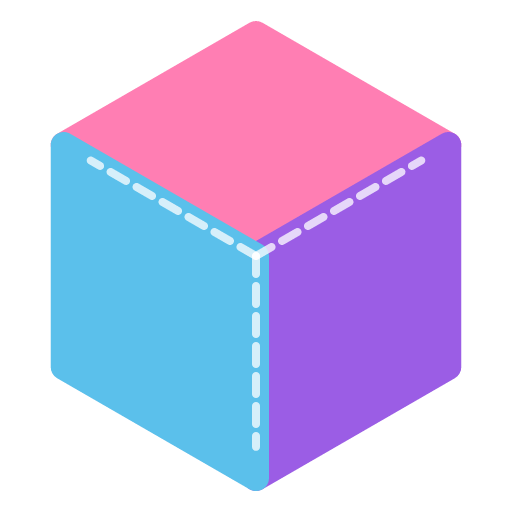

  

<h1 align="center">Patchwork</h1>

  One desktop app for all your coding agents. 
  Run Claude Code, Codex, Antigravity, OpenCode, or your own API model, and check every change before it sticks.

  
  
  

  <a href="https://patchworkeditor.com">Website</a> ·
  <a href="#download">Download</a> ·
  <a href="docs/README.md">Docs</a>

  

<table>
  <tr>
    <td></td>
    <td></td>
    <td></td>
  </tr>
</table>

## What it does

You probably already have an agent CLI you like. Patchwork gives it a proper home: your projects
and tasks in a sidebar, the agent's work laid out step by step, and a diff you review before
anything lands.

- **Every agent, one window.** Claude Code, Codex, Antigravity, OpenCode, and API models all get
  the same chat, plan, and code views. Switching agents is a dropdown, not a new app.
- **You keep what you want.** Each task has Plan, Code, and Diff views. Stage the files you like
  and reject the rest to put them back.
- **You choose how much it does alone.** Supervised, auto-accept edits, auto, or full access, set
  per task. When it needs permission, it asks in the chat.
- **Set a goal, steer as it goes.** Hand it a `/goal` and walk away, or send a message mid-turn to
  change course.
- **Bring your own key.** DeepSeek or any OpenAI-compatible endpoint works from
  **Settings → Providers**.
- **Pick up old sessions.** Import past conversations from Claude Code, Codex, the Gemini CLI, or
  OpenCode and carry on where you left off.
- **It all stays on your machine.** No account, no proxy, no telemetry. Requests go straight from
  your computer to your provider.

There's more: scheduled tasks, skills, MCP servers, hooks, a Usage view for your
subscription limits, and diagrams or HTML mocks that render right in the chat.

## Download

| Platform | Download |
| --- | --- |
| Linux | [`Patchwork_amd64.AppImage`](https://github.com/PolarisPyra/Patchwork/releases/latest/download/Patchwork_amd64.AppImage) |
| Windows | [`Patchwork_x64.exe`](https://github.com/PolarisPyra/Patchwork/releases/latest/download/Patchwork_x64.exe) |
| macOS (Apple silicon) | [`Patchwork_aarch64.dmg`](https://github.com/PolarisPyra/Patchwork/releases/latest/download/Patchwork_aarch64.dmg) |

These links always point at the latest version. On Linux, run `chmod +x Patchwork_amd64.AppImage`
first. None of them is signed with a developer certificate, so the first time, choose More info →
Run anyway on Windows, and on macOS drag Patchwork to Applications, then Control-click it and
choose Open. Settings → Updates says when a new version is out.

## Getting started

1. Install and sign in to at least one agent: [Claude Code](https://docs.claude.com/en/docs/claude-code),
   [Codex](https://github.com/openai/codex), [Antigravity](https://antigravity.google/), or
   [OpenCode](https://opencode.ai/). Patchwork finds it on its own. No CLI? Add an API provider
   under **Settings → Providers** and use the built-in agent.
2. Add a project folder, click **+** to start a task, and pick an agent.
3. When it's done, look over the diff and keep what you want.

Just want to try something? Start a chat from the top of the sidebar. It runs in a throwaway folder
that goes away with the chat.

## Your data

Tasks run right in your project folder. Settings live in `~/.config/patchwork` and app state in
`~/.local/share/patchwork` (macOS and Windows use their own folders, see
[Architecture](docs/architecture.md)). API keys go in your system keychain, or a file only you can
read if there isn't one. [Agent CLIs](docs/agent-clis.md) lists every file Patchwork reads from
your agents.

## Contributing

Bug reports and fixes are welcome. [Development](docs/development.md) covers building from source,
[CONTRIBUTING.md](CONTRIBUTING.md) covers the rest, and the [changelog](CHANGELOG.md) has every
release.

Patchwork is [MIT licensed](LICENSE).
