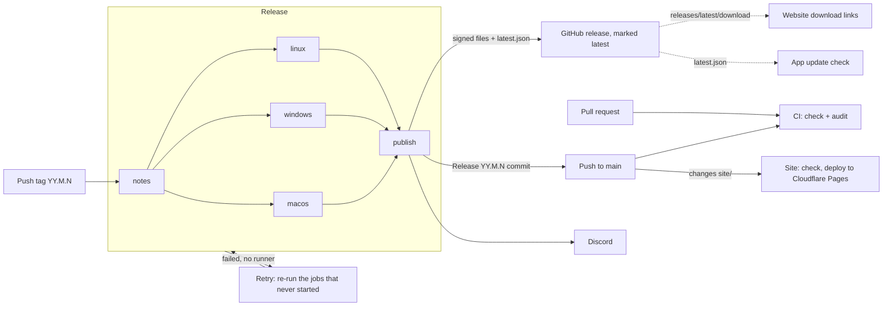

# CI and deploys

The GitHub Actions workflows in `.github/workflows`: what starts each one, what it does when it
fails, the caches and secrets they use, and how long they take.

## The pipeline

| Workflow | Starts on | Jobs |
| --- | --- | --- |
| CI (`ci.yml`) | Every PR, Mondays on `main`, by hand | `check`: rustfmt and clippy with `-D warnings`. `audit`: `cargo audit` against the RustSec advisories |
| Site (`site.yml`) | A PR or a push to `main` that changes `site/`, `.github/deploy/` or the workflow | Checks the pages; on `main`, deploys `site/` to Cloudflare Pages and checks the deployed page |
| Release (`release.yml`), run "Release YY.M.N" | `gh workflow run release.yml` on `main`, or a pushed tag `YY.M.N` | `notes`, then `linux`, `windows`, `macos` side by side, then `publish` ([Releasing](release.md)) |
| Release (`release.yml`), run "Release build check" | `gh workflow run release.yml -f mode=check` | The three builds alone, to refresh their Rust caches and catch a broken release build before a release; publishes nothing |
| Retry (`retry.yml`) | A Release run that failed | Re-runs the run's failed jobs when none of them started, at most twice |

## A pull request

CI runs `check` and `audit`. The ruleset on `main` requires a PR, squash merging and the `check`
check, so `audit` reports an advisory without blocking a merge. A PR that changes the website runs
Site's checks too. Nothing is deployed or published, and no secret is read: a PR from a fork gets
none.

GitHub offers merge queues only for repositories an organization owns, and this one belongs to a
user account, so there is none. A PR's checks run on its merge with `main` as it was at the last
push to the PR, and CI runs once more on `main` after the merge.

## main

Each push to `main` runs CI again, the release commit included, since it rewrites `Cargo.lock`. A
push that changes the website deploys it. Nothing on `main` builds the apps or publishes; only a
tag does.

## A release

Running `gh workflow run release.yml` on `main` (or pushing a tag `YY.M.N`) starts the Release
workflow ([Releasing](release.md)):

1. `notes` writes the notes and the tag's version into `Cargo.toml`, `Cargo.lock` and
   `CHANGELOG.md`, which the builds use.
2. `linux`, `windows` and `macos` build the apps and the five SSH host helpers.
3. `publish` starts only when all three succeeded. It signs every file, checks each signature
   against the key the app carries, writes and signs `latest.json`, uploads them to a draft
   release, and publishes it, so the release is never visible with a file missing. Then it posts to
   Discord and commits "Release YY.M.N" to `main`.

The website's download links are `releases/latest/download/<file>`, which GitHub answers with the
newest published release, and the app reads `releases/latest/download/latest.json`. Both move to a
release the moment `publish` publishes it, and never before. A release is marked latest only when
no published release has a higher version.

## When a job fails

- **A runner never came.** GitHub sometimes has no arm64 Mac free: after about 15 minutes the job
  is cancelled with no steps run, and the run fails before anything was published. Retry sees that
  every failed job has no steps and re-runs them, which re-runs `publish` after them. It tries twice
  more; after that, re-run the failed jobs by hand.
- **A build or check failed.** Retry leaves it alone, since running it again would hide a real
  failure. Nothing was published. Fix the code and tag the fix as the next version, or re-run the
  failed jobs if the cause was outside the code.
- **`publish` failed.** Re-run the failed jobs. Each step is safe to run again: a draft left
  behind gets every file uploaded again, a release already published is left as it is and not
  announced again, and the release commit is skipped when `main` already has the release's
  changelog section.
- **The Discord post failed.** It does not fail the release. Post it by hand.

Re-running a release's failed jobs from the Actions page is always safe. Re-running all its jobs is
safe too, but rebuilds every app.

## Caches

- CI restores one Rust cache (`shared-key: ci`, about 1.3 GB of compiled dependencies), saved only
  by runs on `main`. PRs read it. The three workspace crates are compiled in every run.
- Each Release build job (`linux`, `windows`, `macos`) has its own Rust cache of 1.5 to 1.8 GB,
  also saved only by runs on `main`. A tag's run reads the newest one `main` saved. GitHub keeps
  10 GB per repository and lets a tag's run read only caches saved from `main` or from that tag.
- Each release started on `main` refreshes the Release caches. To refresh them before a release
  after a dependency changes, run a build check on `main` (`gh workflow run release.yml -f mode=check`).

`gh cache list` shows what is stored. A Release build that takes twice as long as usual has
usually found no cache: look for "No cache found" in its `Swatinem/rust-cache` step, then refresh
as above.

## Secrets

| Secret | Read by | For |
| --- | --- | --- |
| `CLOUDFLARE_API_TOKEN`, `CLOUDFLARE_ACCOUNT_ID` | Site | Deploying to the `patchwork-site` Pages project. Without the token the workflow fails. |
| `TAURI_SIGNING_PRIVATE_KEY`, `TAURI_SIGNING_PRIVATE_KEY_PASSWORD` | Release (`publish`) | Signing the release's files |
| `RELEASE_DEPLOY_KEY` | Release | Pushing the release commit to `main` without a PR |
| `DISCORD_RELEASE_WEBHOOK_URL` | Release | Announcing the release; without it nothing is posted |

## Timings

Measured on 2026-11-16 from the 150 most recent CI runs and the 30 most recent Release runs, in
seconds. All run on GitHub's standard runners, which are free for a public repository.

| | p50 | p95 |
| --- | --- | --- |
| CI, from the push to the result | 104 | 129 |
| Waiting for a runner | 2 | 3 |
| Installing the Linux packages | 18 | 33 |
| Installing the Rust toolchain | 9 | 11 |
| Restoring the Rust cache | 22 | 29 |
| Format | 3 | 3 |
| Lint | 16 | 20 |
| Test (168 tests, which run in 1.5 to 5 seconds; the rest is compiling) | 26 | 33 |
| Release, from the tag to the last job | 618 | 946 |
| Release build job: Linux / Windows / macOS | 490 / 322 / 504 | 625 / 403 / 924 |

The CI cache was found in each of the 15 runs sampled. Two of the 150 runs compiled every
dependency, and took 780 and 811 seconds.

The tests are not split across jobs, because they run in under 5 seconds. A second job would
spend about 50 seconds installing packages and restoring the cache before it compiled anything.

## Before a push

The `pre-push` hook runs the format and lint checks locally; see
[Development](development.md#git-hooks).
